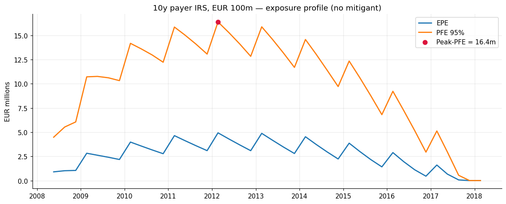
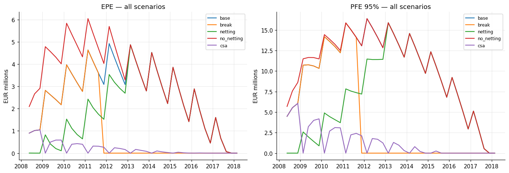

# Counterparty credit risk under the Hull-White model

Monte Carlo estimation of counterparty credit exposure on an interest rate swap
portfolio, simulated under the one-factor Hull-White (extended Vasicek) model:
EPE, PFE, Peak-PFE and CVA, with three risk mitigants — a mandatory break
clause, a close-out netting agreement and a one-sided CSA.

**Case study.** 15 February 2008. A bank enters a vanilla 10y payer interest rate
swap on a EUR 100m notional (3M Euribor floating leg, annual 30E/360 fixed leg)
and measures the counterparty risk it has just taken on, using 250 000
simulations over 40 quarterly dates.



## Results

Curve bootstrapped on 19 February 2008; Hull-White parameters `a = 2.05%`,
`sigma = 0.94%`; 250 000 scenarios, seeded.

| Scenario | Max EPE | Peak-PFE 95% | Peak date | CVA | vs base |
|---|---:|---:|---:|---:|---:|
| Uncollateralised 10y swap | 4.93 m | 16.39 m | Feb 2012 | 244 139 | — |
| Mandatory 3.5y break | 4.64 m | 15.86 m | Feb 2011 | 102 760 | −58% |
| Two trades, no netting | 6.05 m | 16.39 m | Feb 2012 | 313 548 | +28% |
| Two trades, netted | 4.88 m | 15.88 m | Feb 2013 | 159 661 | −35% |
| CSA, annual margin calls | 1.05 m | 6.06 m | Nov 2008 | 21 344 | −91% |

CVA in EUR, LGD 60%, flat hazard rate 200 bp.



Three observations worth more than the numbers themselves:

- **A break clause cuts the tail, not the peak.** The exposure profile of a par
  swap peaks in the first third of its life, so terminating at 3.5y removes more
  than half of the CVA while leaving the Peak-PFE almost unchanged. Mandatory
  breaks earn capital relief by shortening effective maturity, not by lowering
  peak exposure.
- **Netting moves the mean and the tail differently.** Without netting, the PFE
  is *identical* to that of the 10y swap alone while the EPE is 23% higher. In a
  one-factor model the payer and the receiver swap are perfectly anti-correlated:
  the scenarios in the 95th percentile of the first are exactly those where the
  second is worthless, so the tail sees no difference. The average does.
- **Annual margining leaves a year of gap risk.** Collateral drives the exposure
  to zero at each posting date but not between them — which is the whole argument
  for daily margining.

CVA sensitivities, each computed by full revaluation of the exposure profile
under the bumped input, with common random numbers across runs:

| Risk factor | Bump | ΔCVA (EUR) |
|---|---|---:|
| Interest rates, parallel | +1 bp | +1 804 |
| Counterparty hazard rate | +1 bp | +1 119 |
| Hull-White volatility | +1 bp | +2 720 |

All three are positive: the position is a payer swap (CVA is directional), the
credit leg enters linearly, and the exposure is an option-like payoff, so CVA is
long volatility.

## Method

The short rate is `r_t = phi(t) + x_t`, with `phi` the deterministic shift that
fits the initial curve and `x` a driftless Ornstein-Uhlenbeck process. Rather
than re-integrating `phi` scenario by scenario, the whole simulated curve is
rebuilt from the single state variable through the affine representation

```
B(s, tau) = A(s, tau) * exp(-x_s * C(s, tau))
A(s, tau) = B(0, tau)/B(0, s) * exp(-1/2 * I(s, tau))
C(s, tau) = (1 - exp(-a(tau - s)))/a
```

where `I(s, tau)` is the variance term of the notes, evaluated here in closed
form through the variance of the integrated state variable and cross-checked
against numerical quadrature in the test suite.

`x` is simulated with its exact transition law (Gaussian, mean `x_t e^{-a dt}`,
variance `sigma^2/(2a)(1 - e^{-2a dt})`), so the scheme carries no discretisation
bias whatever the step size. Valuation is single-curve, consistent with the 2008
data set: discounting and forward projection use the same curve, and the swap is
valued only on reset dates of the floating leg, which is why the floating leg is
worth `1 - B(s, T_N)` with no accrual term.

## Repository layout

```
src/ccr/
    dates.py            day-count conventions, schedules
    market_data.py      CSV loading and quote normalisation
    curve.py            discount curve, bootstrap (depos / futures / swaps)
    synthetic_curve.py  offline Svensson fallback curve
    curve_source.py     picks market data or fallback automatically
    swap.py             schedules, BPV, par rate, MtM (spot and path-wise)
    hull_white.py       OU simulation, affine coefficients
    exposure.py         EPE / ENE / PFE / Peak-PFE, CSA collateral mechanics
    engine.py           Monte Carlo loop over the simulation grid
    cva.py              CVA and its sensitivities
notebooks/
    ccr_exposures.ipynb   the analysis, start to finish
tests/                    55 tests, 49 of which run without market data
figures/                  output of the notebook
```

## Running it

```bash
pip install -r requirements.txt
pytest                                     # 55 tests
jupyter lab notebooks/ccr_exposures.ipynb  # full analysis, ~30 s at 250k scenarios
```

**It runs straight after cloning.** The market quotes are not redistributed
with this repository, so when `data/` holds no CSV files the discount curve
falls back automatically on a Svensson parametrisation fitted to the original
bootstrapped curve (`src/ccr/synthetic_curve.py`, six parameters). Every cell
of the notebook still runs, and the results stay close to the published ones:

| | Market data | Fallback | Difference |
|---|---:|---:|---:|
| 10y par rate | 4.4340% | 4.4358% | +0.2 bp |
| Peak-PFE, base | 16.39 m | 16.48 m | +0.6% |
| CVA, base | 244 139 | 246 731 | +1.1% |
| CVA, netted | 159 661 | 163 062 | +2.1% |
| CVA, CSA | 21 344 | 21 455 | +0.5% |

The fit is within 2.5 bp of the bootstrapped curve from two years onwards. It
cannot follow the money-market structure of February 2008 below two years — a
hump around six months, then a dip priced by the futures strip — and misses it
by up to about 20 bp there; that is where the small differences come from.

To reproduce the published figures exactly, drop the five CSV files described
in [`data/README.md`](data/README.md) into `data/`: the bootstrap then takes
over automatically. Tests that need the files skip when they are absent.

## Provenance and corrections

This project started as a graduate assignment (Risk Management, Financial
Engineering MSc, Politecnico di Milano) built on skeleton code containing gaps
to fill and deliberate errors to find. The repository is a full rewrite —
package structure, tests, reproducible seeding — and the substantive corrections
made along the way are listed below, since finding them was most of the work.

**Errors that changed the results**

1. **Sign of the convexity term in the affine coefficients.** `A(s, tau)` was
   computed with `exp(+I/2)` instead of `exp(-I/2)`, placing simulated discount
   factors *above* the forward curve. The 10y discount factor seen from 5y was
   overstated by 148 bp, biasing the entire exposure profile.
2. **Fixed leg built without accrual factors.** Cash flows were set to `K`
   rather than `K * delta_i`. Invisible on an annual leg (`delta ≈ 1`), it
   inflates a quarterly leg roughly fourfold: the 5y swap of the netting
   scenario was worth −81m at inception instead of zero, making both netting
   scenarios meaningless.
3. **CSA parameters contradicting the term sheet.** A 2m threshold on the bank
   with an uncapped exposure meant the bank posted collateral, and a 15m cap on
   the counterparty meant it did not cover its exposure in full — the opposite of
   what the case study specifies on both sides.
4. **Rate shock applied to futures prices.** In the bumped bootstrap the shift
   was added to the quoted price rather than to the implied rate
   `(100 - price)/100`, turning a +1 bp rate shift into a −100 bp shift on the
   futures strip, and with it the whole IR01.
5. **Exposure of the second trade standalone was never computed**, although the
   netting question asks explicitly for the comparison of the netted portfolio
   against the individual trades.
6. **Rate sensitivity computed on a frozen exposure profile**, re-discounting
   the same EPE under a bumped curve. The dominant effect of a rate shift runs
   through the mark-to-market of the swap, hence through the exposure itself;
   both sensitivities are now full revaluations.
7. **Inconsistent time measures**, ACT/360 in the simulation of the state
   variable against ACT/365 in the pricing functions, biasing its variance by
   1.4%. A single model basis is now defined in one place.

**Latent defects**

8. Zero-rate interpolation anchored on a spurious `z(0) = 0` node, distorting
   discount factors before the first pillar instead of extrapolating flat.
9. Conventions mixed inside the curve module itself: zero rates returned in
   ACT/360 while the interpolator rebuilt them in ACT/365.
10. No random seed, so no result could be reproduced; the number of futures used
    in the bootstrap hard-coded rather than derived from the 2y pillar; margin
    calls triggered by a `>= 360 days` heuristic instead of an explicit
    schedule; a local variable shadowing the `datetime` module inside the
    simulation routine.

**Deliberately left as-is, and documented**

The 1y point of the curve comes from the futures strip, not from the 1y swap
quote, and therefore misses it by about 12 bp — that is the futures/swap basis of
February 2008 and a property of the pillar selection, not an error. A test pins
the value so that an accidental change of construction is caught.

## References

- Brigo, D. and Mercurio, F. (2006), *Interest Rate Models — Theory and
  Practice*, 2nd ed., chapters 3 and 4.
- Gregory, J. (2020), *The xVA Challenge*, 4th ed.
- Hull, J. and White, A. (1990), "Pricing Interest-Rate-Derivative Securities",
  *Review of Financial Studies* 3(4).
